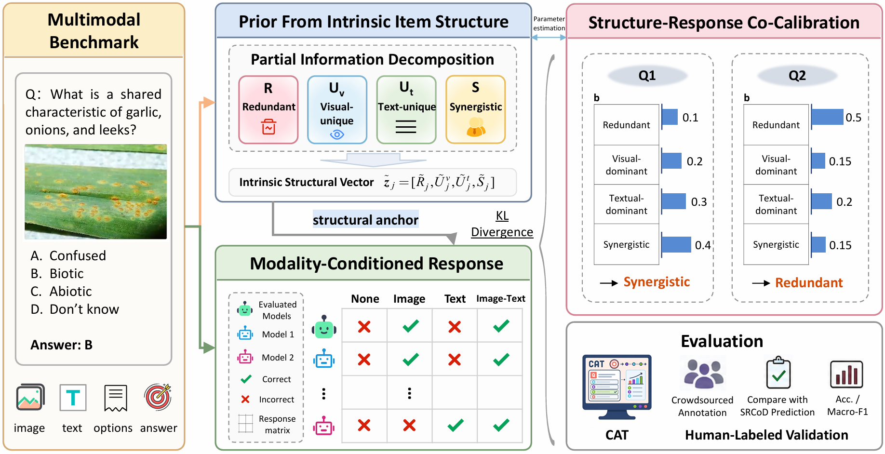

# SRCoD

**Accepted at NeurIPS 2026, Evaluations & Datasets Track (Poster)**

**Paper:** *Are Multimodal Benchmarks Really Useful? Item-Level Multimodal Benchmark Diagnosis via Structure-Response Co-Calibration*

SRCoD (**S**tructure-**R**esponse **Co**-calibrated **D**iagnosis) is a framework for item-level multimodal benchmark diagnosis. It combines an intrinsic structural prior, estimated from item-level multimodal interactions, with modality-conditioned responses from vision-language models (VLMs). The resulting diagnostic profile characterizes the evidence dependence of each benchmark item.

<p align="center">
  
</p>


---

## Overview

Multimodal benchmarks are widely used to evaluate whether vision-language models can reason over information from multiple modalities. However, some benchmark items may be answerable from a single modality or from answer-option regularities alone, which makes aggregate accuracy insufficient for diagnosing true cross-modal reasoning ability.

SRCoD addresses this problem through **item-level benchmark diagnosis**. Given a multimodal benchmark, SRCoD:

1. estimates item-level multimodal benchmark structure information with PID metrics;
2. collects model responses under controlled modality conditions;
3. anchors a modality-conditioned response model with intrinsic structural priors;
4. produces a calibrated diagnostic profile for each item.

This repository contains the minimal code needed to:

- `srcod/`: dataset loaders, prompt construction, model clients, response collection, and SRCoD.
- `scripts/collect_responses.py`: collect response matrices with Ollama or a generic OpenAI-compatible API.
- `scripts/train_srcod.py`: train SRCoD from a response matrix and an external LSMI metrics CSV.
- `scripts/verify_package.py`: verify externally provided data, labels, images, and packaging constraints.

The public human-annotation dataset is **hosted separately on Kaggle**; original third-party benchmark images and questions are **not** included in this code repository or in the labels-only Kaggle release.

## Data availability

**SRCoD: Human-Annotated Multimodal Diagnosis**  [Kaggle release](https://www.kaggle.com/datasets/nudtdmzzh/srcod-human-annotated-multimodal-diagnosis/versions/4)

The release contains 3,000 human diagnostic labels, with 1,000 fixed examples from each of **ScienceQA**, **MMMU**, and **SEED-Bench**. Each `labels.csv` contains only `item_id` and `source_type_label`.

| Source benchmark | Redundant | Visual-dominant | Textual-dominant | Synergistic | Total |
| --- | ---: | ---: | ---: | ---: | ---: |
| ScienceQA | 475 | 250 | 154 | 121 | 1,000 |
| MMMU | 266 | 172 | 169 | 393 | 1,000 |
| SEED-Bench | 267 | 339 | 117 | 277 | 1,000 |
| **Total** | **1,008** | **761** | **440** | **791** | **3,000** |

The Kaggle download includes a `MANIFEST.json` with frozen sample identifiers and content fingerprints, along with reconstruction instructions. Refer to the dataset README and the paper's Appendix C for the sampling and human-annotation protocol. The diagnostic labels are used **for evaluation**, not to fit SRCoD.


### Obtain the original benchmarks

The labels-only release does not redistribute source questions, options, answers, or images. Obtain them through their respective official channels, subject to each source's license and access requirements:

- [ScienceQA](https://github.com/lupantech/ScienceQA): `problems.json` and the official split-specific images.
- [MMMU](https://huggingface.co/datasets/MMMU/MMMU): original subject/split Parquet files. For test-split samples, also obtain the [official test answer file](https://github.com/MMMU-Benchmark/MMMU/blob/main/mmmu/answer_dict_test.json).
- [SEED-Bench](https://github.com/AILab-CVC/SEED-Bench): `SEED-Bench.json` and original `SEED-Bench-image/` assets.

The reconstruction script checks sample identifiers and content/image hashes against the release manifest. An upstream dataset revision that changes an item can cause reconstruction to stop rather than silently change the evaluation set.


## Install

```bash
pip install -r requirements.txt
```

## Verify Package

Run this after placing the external data under `data/`.

```bash
python scripts/verify_package.py
```

## Collect Responses

Ollama example:

```bash
python scripts/collect_responses.py \
  --dataset ScienceQA \
  --backend ollama \
  --models qwen2.5vl:7b \
  --max-items 2
```

OpenAI-compatible API example:

```bash
set OPENAI_API_KEY=your_api_key
python scripts/collect_responses.py \
  --dataset ScienceQA \
  --backend openai \
  --models gpt-4o-mini \
  --max-items 2
```

For compatible services, pass `--base-url` explicitly. No third-party endpoint or key is hard-coded in this package.

The response collector does not set `max_tokens` for OpenAI-compatible calls and does not set `num_predict` for Ollama calls.

## Train SRCoD

SRCoD requires an external CSV file containing item-level PID metric estimates. These structural-prior files can be estimated with the external estimator code at [LSMI_Estimator](https://github.com/GeWu-Lab/LSMI_Estimator). The expected metrics correspond to item-level multimodal interaction components, including redundant, visual-unique, textual-unique, and synergistic evidence.

```bash
python scripts/train_srcod.py \
  --responses-path outputs/ScienceQA_responses/responses.parquet \
  --lsmi-metrics-path path/to/question_level_metrics.csv \
  --labels-path data/ScienceQA/labels.csv \
  --epochs 300 \
  --output-dir outputs/ScienceQA_srcod
```

## License

The source code is released under the MIT License.
The human-annotated dataset is licensed under CC BY 4.0.

Third-party benchmark materials remain subject to their original licenses.

## Citation

If you use SRCoD or the diagnostic annotations, please cite the accompanying paper:

> Shiqi Zhang, Weixin Zeng, Ziheng Zhang, Jiuyang Tang, and Xiang Zhao. *Are Multimodal Benchmarks Really Useful? Item-Level Multimodal Benchmark Diagnosis via Structure-Response Co-Calibration.* NeurIPS 2026, Evaluations & Datasets Track (Poster).


